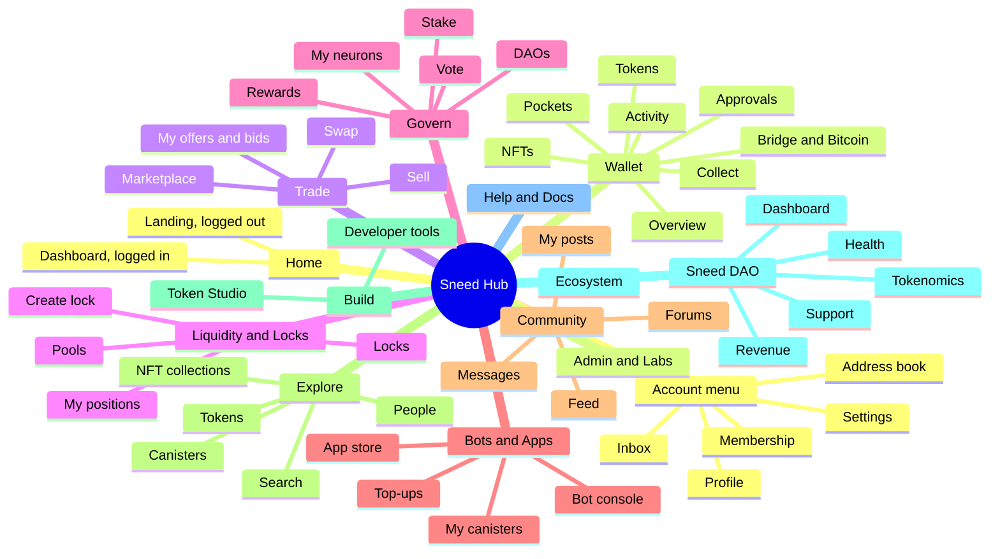

# Sneed Hub redesign: proposed sitemap

A proposed structure for a redesigned Sneed Hub frontend. It is built from the [functionality catalog](../frontend-catalog/README.md) (snapshot `ecc0eadf`), and every capability the catalog lists has a place in it.

- **Scope:** front end only. The structure reuses what the canisters already expose. Where a page needs something the backend doesn't offer yet, it says so (see [New pages the structure needs](#new-pages-the-structure-needs)).
- **URLs are illustrative.** They show the shape: section prefixes, kebab-case, ids in the path, `new` for create flows, and tabs as path segments so every view can be linked.
- **Domain and login:** the site moves to `sneedhub.app` (one origin, sections as the path prefixes below), and II logins derive from the new frontend canister's URL. See [Domain and login origin](domains-and-login-origin.md) before building login.
- **Coverage:** all 159 current routes plus `btc.html` are placed in the [appendix](#appendix-where-every-current-route-goes). 118 pages survive (most at a new URL), 20 merge into another page, 7 split across pages, 9 old aliases become redirects, and 6 placeholders or broken pages are dropped.

## The structure at a glance



Nine job sections make up the main navigation. Sneed DAO, Help & Docs and Admin sit below a divider. Account, settings and the inbox live in the top bar, not the sidebar.

## Design rules behind it

Each rule answers a finding in the catalog (section numbers refer to [its findings](../frontend-catalog/README.md#3-findings-for-the-restructure)).

1. **Sections are jobs, not brands.** The navigation says what you do: Trade, Govern, Liquidity & Locks. Sneedex, Sneed Lock and Sneedapp stay as product names on their pages ("Marketplace · Sneedex"). Today's menus mix brand, personal-vs-public and job axes (catalog §1).
2. **One home per object.** Every entity has one canonical page, addressed by id. It shows public information to everyone and adds the owner's actions when you control it. Wallet cards, lists and popups link there instead of carrying their own management UI. This removes most of the duplication in §3.2 and §3.9.
3. **"Mine" and "All" are tabs, not sections.** The split between Sneed Me and Sneed Hub goes away. Locks has *Mine* and *All* tabs, the marketplace has *Browse* and *My offers & bids*, and so on. The Home dashboard and Wallet overview are the only cross-cutting "my stuff" pages.
4. **Flows live where their result lives,** and every object offers the relevant flows, prefilled. "Sell" on any token, neuron, bot, NFT, lock or position opens `/trade/market/new` with that asset. "Lock" opens `/locks/new`. "Stake" opens `/govern/stake/sns`.
5. **One component per action.** Send, Receive, Swap, Top up, Upgrade, Vote, Message and Confirm are each one shared dialog, used everywhere. Today they have 2 to 5 implementations each (§3.2).
6. **The DAO is in the URL.** DAO-scoped pages live under `/dao/:dao/…`, and the NNS is the DAO `nns`, so SNS and NNS share one set of templates. Picking a DAO no longer silently changes what every other page shows (§1.6). The last DAO you visited is only remembered as a default.
7. **One shell, rendered once, driven by the route table.** The active nav item comes from the route config, not from hard-coded URL lists (§3.1). Tabs are URL segments, so `?tab=` deep links stop being ignored.
8. **Only live features in the navigation.** Admin previews move to Labs and placeholders are dropped (§3.5).
9. **Settings live in one place.** Each section has a gear that opens its group of `/settings`. Today they are split over four places (§1.1).
10. **Help is contextual.** Every page header has a "?" that opens its help topic (§1.12).

## The shell

Every page renders inside one layout.

```
Desktop
+--------------------------------------------------------------------------+
| Sneed Hub  [ Search people, tokens, canisters, proposals... ]  Inbox  Msg  (avatar) |
+--------------+-----------------------------------------------------------+
| Home         |  Wallet > Pockets                              [?] [gear] |
| Wallet       |  Overview  Tokens  Pockets  NFTs  Approvals  Activity ... |
| Trade        |                                                           |
| Liquidity &  |  (page)                                                   |
|   Locks      |                                                           |
| Govern       |                                                           |
| Bots & Apps  |                                                           |
| Community    |                                                           |
| Explore      |                                                           |
| Build        |                                                           |
| ------------ |                                                           |
| Sneed DAO    |                                                           |
| Help & Docs  |                                                           |
| Admin (role) |                                                           |
+--------------+-----------------------------------------------------------+
  Footer: About Sneed DAO . Donate . Feedback . Docs . Disclaimer

Phone
+----------------------------+
| Sneed Hub   Search Inbox (o)|
| Wallet: Tokens Pockets ... |
|                            |
|  (page)                    |
|                            |
+----------------------------+
| Home Wallet Trade Govern Menu |
+----------------------------+
```

| Element | What it holds | Replaces |
|---|---|---|
| **Sidebar** (desktop, collapsible) | All sections at once; the current section expands to its pages | The hidden section switcher and the single submenu row |
| **Bottom bar** (phone and installed app) | Home, Wallet, Trade, Govern, Menu (the full sidebar as a sheet) | The Back/Forward/Refresh bar; the submenu that slides away on scroll |
| **Global search** | Principals and names, tokens, canisters, neurons, proposals, offers, locks, transactions. It recognises ids by shape and resolves names | One input per explorer |
| **Inbox** (bell, with a count) | One notification center: see `/inbox` | The header alert chips and the separate Notifications service |
| **Messages** (icon, with a count) | Opens `/messages` | The messages chip |
| **Account menu** (avatar) | Profile, membership, address book, devices, settings, theme, currency, privacy (Shift+P still works), log out. Shows principal and account id with copy | The quick-wallet popup (a second wallet), the Quick Links dropdown |
| **DAO header** (only on `/dao/:dao/…`) | DAO logo and name, a switcher that changes the URL, your voting power here, "Refresh neurons" | The header SNS picker and VP bar on about 16 pages |
| **Page header** | Breadcrumb, title, tabs, "?" help, gear for the section's settings | Per-page `<Header>` copies |
| **Shared dialogs** | Send, Receive, Swap, Top up, Upgrade, Vote, Message, Confirm (with "cannot be undone" wording for irreversible actions), Person menu | 2–5 implementations of each |
| **Person menu** | Message, nickname, view profile, copy. Opens on click as well as right-click or long-press | Right-click-only menu |
| **Footer** | About Sneed DAO, Donate, Feedback, Docs, Disclaimer | The donate heart in the header |
| **Global notices** | Session expired, update available, staging, unfinished stakes and top-ups (one notice, linking to Home) | Notices repeated in 6+ places |

Logged-out visitors see the same shell. Personal sections show what they would do and a "Log in" button, never a form that does nothing.

## Sitemap

Each table lists the pages of one section: the path, what the page holds, and which of today's pages and components it absorbs.

### Home

| Path | Page | Contents and actions | From today |
|---|---|---|---|
| `/` | Home | **Logged out:** what Sneed Hub is, SNEED stats, product cards, live forum and market widgets. **Logged in:** portfolio total; *Needs attention* (proposals to vote on, fees, rewards and maturity to collect, low cycles, outdated bots, unfinished stakes and top-ups, unread replies and messages); quick actions Send, Receive, Swap, Vote; recent activity | `/`, `/hub`, the header alert chips (as a list), `/me` stats tiles |

### Wallet

What I hold, and moving it. Token, NFT and transaction pages are canonical in Explore; the wallet links to them.

| Path | Page | Contents and actions | From today |
|---|---|---|---|
| `/wallet` | Overview | Total value in the display currency, allocation charts, holdings by kind (tokens, LP positions, locks, neurons, NFTs, bots), each row linking to its home page | `/wallet` header and Statistics tab, `/me` hero stats |
| `/wallet/tokens` | Tokens | Token list: add by ledger id, scan, reorder, hide dust, remove at zero. Each row has Send, Receive and Swap, and opens the token page on its *Yours* tab | `/wallet` Tokens tab |
| `/wallet/pockets` | Pockets | Every place your tokens sit: Main, subaccounts, the Sneed Lock balance (one name everywhere), Sneedex escrows, ICPSwap leftovers, service balances, the BTC address. Create, rename, hide, receive, send, move, withdraw, "Move all to Main" | `/wallet/pockets`, the pocket switcher, the Sneed Lock Deposit/Withdraw dialogs |
| `/wallet/nfts` | NFTs | My ICRC-7 and EXT collections, "Add collection". Per NFT: send, sell, use as avatar. Diamond Club banner | `/nft` |
| `/wallet/approvals` | Approvals | Everyone who can spend your tokens (ICRC-2) or NFTs (ICRC-37), filterable by pocket. Revoke, change amount or expiry | Wallet Approvals tab, token-card badges, NFT-card approvals, pocket approvals |
| `/wallet/activity` | Activity | Your transactions across tokens and pockets, with filters and CSV | `/me` Transactions tab, `/transactions` account mode. The wallet has no history today |
| `/wallet/collect` | Collect | Everything claimable (LP fees, voting rewards, SNS maturity), with a threshold and "Claim all" | Wallet Collect card, header collectibles chip (ConsolidateModal) |
| `/wallet/bridge` | Bridge | Get or withdraw ckBTC, ckETH and ckERC-20 | `/convert` |
| `/wallet/bitcoin` | Bitcoin | Native BTC: send, sweep, move BTC ⇄ ckBTC, signing credit, activity, speed up a stuck send | `btc.html` (can stay a separate entry, but gets a nav item) |

### Trade

| Path | Page | Contents and actions | From today |
|---|---|---|---|
| `/trade/swap` | Swap | Quotes (ICPSwap pools plus Sneedex buyouts), slippage, swap. Quotes show for logged-out visitors too | `/swap`; the SwapModal, which becomes the shared Swap dialog |
| `/trade/market` | Marketplace | Browse, search, filter and sort offers, with USD estimates | `/sneedex_offers`, Hub and feed widgets |
| `/trade/market/:offerId` | Offer | Assets with due diligence: a summary per asset, linking to its canonical canister, bot, neuron, lock or NFT page instead of re-rendering it. Bid history. Buyer: bid, buyout, claim. Seller: escrow, activate, accept, cancel, claim payment | `/sneedex_offer/:id` |
| `/trade/market/new` | Sell | The 4-step offer wizard. `?asset=kind:id` arrives prefilled from "Sell" on any sellable object | `/sneedex_create` |
| `/trade/market/mine` | My offers & bids | *Offers* and *Bids* tabs, with every settle action, including Refund bid and withdrawing escrow | `/sneedex_my`, escrow withdrawals in pockets |
| `/trade/market/about` | About Sneedex | How it works, fees | `/sneedex` |

### Liquidity & Locks

| Path | Page | Contents and actions | From today |
|---|---|---|---|
| `/liquidity` | My positions | Every ICPSwap position you own: held directly, deposited in Sneed Lock, or locked. Value and unclaimed fees; collect all; import | Wallet Liquidity tab, `/positions` (mine) |
| `/liquidity/pools` | Pools | Pools you've registered, plus a pool browser with stats | Wallet "+ Add Swap Pair", pool pickers |
| `/liquidity/pools/:poolId` | Pool | Stats, all positions, open a position, withdraw unused pool balance | `/positions?swap=`, `/position` open mode |
| `/liquidity/pools/new` | Create pool | Paid pool creation | `/position` with no params |
| `/liquidity/positions/:poolId/:positionId` | Position | Amounts, range, fees owed, owner, value. Owner: collect, move range, add or remove liquidity, transfer (with the recipient guard Send has), lock, sell, withdraw. Every one of these asks for confirmation | `/position`, wallet position card, popup |
| `/liquidity/import` | Import from ICPSwap | The one guide for moving a position in | Four copies today |
| `/locks` | Locks | *Mine* and *All* tabs; TVL; filters by token, owner and state | `/sneedlock_info`, wallet Locks tab, `/me` "My Locks" |
| `/locks/new` | Create lock | Token or position lock: available balance, fee tier, expiry, dissolve delay, pool check, "cannot be undone" warning. The only lock flow | `/lock_wizard`, wallet LockModal and LockPositionModal |
| `/locks/:id` | Lock | Summary and value. Dissolve, delay, extend, add gas, transfer (as NFT), sell. Position locks add claim fees, add liquidity, withdraw after expiry | `/lock/:id`, the wallet-only lock actions, `/tokenlock`, `/positionlock` |
| `/locks/about` | About Sneed Lock | How it works, fees | `/sneedlock` |

A token's locks are also a tab on its token page (`/tokens/:ledger/locks`).

### Govern

`:dao` is an SNS root id or a short slug (`sneed`), or `nns`.

| Path | Page | Contents and actions | From today |
|---|---|---|---|
| `/govern` | Vote | Every open proposal you can vote on, across all SNSes and the NNS. Vote per row or in bulk per DAO; "Show only votable" | `/active_proposals`, header votable chip |
| `/govern/neurons` | My neurons | Every neuron you control or hotkey, grouped by DAO, with voting-power totals: SNS neurons, hotkeyed NNS neurons, and bot-owned NNS neurons (linking to the bot) | Wallet Neurons tabs, `/me` My Neurons, header VP bar |
| `/govern/stake` | Stake | Three ways in: stake SNS tokens, stake ICP through a Staking Bot, import a neuron. A liquid-staking explainer; unfinished stakes | `/liquid_staking`, pending-stake notices |
| `/govern/stake/sns` | Stake SNS tokens | Neuron creation wizard | `/sns_neuron_wizard`, wallet "Create New Neuron" |
| `/govern/stake/icp` | Stake ICP | Staking Bot intro; minting runs through the store's mint wizard | `/create_icp_neuron` |
| `/govern/stake/import` | Import a neuron | The jailbreak wizard, under a name that says what it does | `/tools/sns_jailbreak` |
| `/govern/stake/import/scripts` | My import scripts | Re-show, verify, delete, withdraw ICP | `/tools/sns_jailbreak_list` |
| `/govern/rewards` | Voting rewards | Claimable per token, claim, history | `/rewards`, the claim part of `/rll`, wallet card claims |
| `/daos` | DAOs | Every SNS plus the NNS: logo, token, price, your stake | `/sns` list |
| `/dao/:dao` | DAO home | Token, governance parameters, hotkey policy, reward parameters, canister health, your neurons here; links to proposals, neurons, forum and canisters | `/sns` detail |
| `/dao/:dao/proposals` | Proposals | Filters, "load all", CSV, quick vote | `/proposals`, `/icp_proposals` |
| `/dao/:dao/proposals/:id` | Proposal | Summary, payload, tally against threshold, ballots, the shared Vote panel, discussion | `/proposal`, `/icp_proposal` |
| `/dao/:dao/proposals/new` | File a proposal | Starts with Sneed DAO. Mounts the pipeline that is already built (governance registry, proxy payloads); Mr Sneed changes become proposal types here | `/mr-sneed` propose dialogs, the unmounted ProposeDialog, the external ic-toolkit link |
| `/dao/:dao/neurons` | Neurons | Explorer with CSV, plus a visible *Holders* tab | `/neurons`, hidden `?tab=stakers` |
| `/dao/:dao/neurons/:id` | Neuron | Public stats and voting history. When you control it, every action: stake, dissolve, disburse, maturity, split, send, permissions, followees, public name, nickname, sell | `/neuron`, wallet Neurons tab, `/me` neuron names. `/dao/nns/neurons/:id` is new |
| `/dao/:dao/canisters` | DAO canisters | System, dapp and archive canisters, with health | `/apps` SNS root folders |

### Bots & Apps

| Path | Page | Contents and actions | From today |
|---|---|---|---|
| `/apps` | My canisters | Everything you control or track: bots, apps, canisters. Groups and subgroups, health lamps, cycles, outdated flags, bulk Top-up and Upgrade. Items move by drag or by a "Move to…" menu that works on touch | `/apps`, wallet Apps tab, store "My Canisters", popup DappCardModal |
| `/apps/store` | App store | Browse apps: price, Premium price, publisher, families | `/sneedapp` |
| `/apps/store/:appId` | App | Description, versions, price, publisher | `/sneedapp/app/:appId` |
| `/apps/store/:appId/mint` | Mint | One wizard for every app, the Staking Bot included | `/sneedapp/mint/:appId`, the `/create_icp_neuron` mint |
| `/apps/publishers/:id` | Publisher | Public view for everyone; the console for owners | `/sneedapp/publisher/:id`, which shows "You are not an owner" to everyone else |
| `/bots/:id/:tab` | Bot console | One shell for both bot types. Shared tabs: Overview (status, official-version check, controllers), Chores, Botkeys, Log & events, Cycles & upgrades. The Staking Bot adds Neurons (Stake, Maturity, Following, Dissolve, Disburse, Hot keys, Advanced). The Trading Bot adds Setup, Strategy, Wallet, Performance, Circuit breaker, Quick trade, Script, Recovery. Tabs show only what your botkeys allow | `/icp_neuron_manager/:id`, `/trading_bot/:id`, DappCardModal chores |
| `/canisters/:id` | Canister | Public status; top up with ICP or card. Controllers: controllers, upgrade or reinstall, public name. Anyone: nickname. "Open bot console" when it is a bot | `/canister` |
| `/apps/top-ups` | Top-ups | Unfinished top-ups, and recovery by block index | `/tools/recover-topup`, notices in 6 places |

### Community

| Path | Page | Contents and actions | From today |
|---|---|---|---|
| `/feed` | Feed | Activity across DAOs, with a DAO filter; market events included | `/feed` |
| `/dao/:dao/forum` | Forum | Topics; create the forum or special topics. The sidebar's "Forums" opens the last DAO's forum, with a switcher | `/forum` |
| `/dao/:dao/forum/topics/:id` | Topic | Threads with their score, reactions and tips; new thread, optionally with a poll | `/topic/:topicId` |
| `/dao/:dao/forum/threads/:id` | Thread | Posts, votes, reactions, tips, polls, mentions | `/thread` |
| `/dao/:dao/forum/posts/:id` | Post | One post with its vote breakdown | `/post` |
| `/messages` | Messages | Conversations by default, plus Inbox and Sent lists; one composer | `/sms`, the global MessageDialog |
| `/messages/:id` | Message | One message or conversation | `/msg/:id` |
| `/community/mine` | My posts | My posts, my threads, tips sent and received (posts and threads) | `/posts` (My Posts, My Threads), `/tips`, `/me` tiles |

Replies and mentions move to `/inbox`.

### Explore

Public data about anyone and anything, mostly reached through global search.

| Path | Page | Contents and actions | From today |
|---|---|---|---|
| `/explore` | Explore | Search box and directory cards: People, Tokens, DAOs, Canisters, NFT collections, Locks, Pools, Marketplace | New; the Hub's explorer cards |
| `/users` | People | Directory of named principals | `/users` |
| `/users/:principal/:tab` | Profile | *Overview* (name, avatar, badges, totals), *Posts*, *Market* (offers and bids), *Neurons*, *Holdings*, *Activity*. Message, nickname. On your own profile, "Edit profile" | `/principal`, `/user`, `/scan_wallet` |
| `/tokens` | Tokens | Whitelisted tokens with price and market data | New (Studio picker, wallet scan list) |
| `/tokens/:ledger/:tab` | Token | *Overview* (price, supply, metadata, pools). *Yours* (balance by pocket, history, your neurons, locks and rewards in this token; Send, Receive, Swap, Lock, Stake, Sell). *Safety* (the ~39 checks). *Locks*. *Liquidity*. *Transactions*. *Block log*. *Flows* | Wallet token card, `/studio/:ledgerId`, `/tokenlocksoverview`, `/transactions?ledger=`, `/tools/icrc3`, `/tools/money` |
| `/tokens/:ledger/transactions/:index` | Transaction | One block, Previous/Next | `/transaction` |
| `/canisters` | Canisters | Named canisters, plus lookup by id | `/canisters` |
| `/nfts/:collection` | Collection | Any ICRC-7 collection | `/nfts` |
| `/nfts/:collection/:tokenId` | NFT | Media and metadata. Owner: send, approve, sell, use as avatar. Lock NFTs link to their lock | `/nft_item` |

DAOs, locks, pools and the marketplace are explorers too; their pages sit in their own sections and Explore links to them.

### Build

For token teams and developers. Lists only what is live.

| Path | Page | Contents and actions | From today |
|---|---|---|---|
| `/build` | Build | What's here and who it's for | `/tools/main` |
| `/studio` | Token Studio | Pick a token you own | `/studio` |
| `/studio/:ledger/:tab` | Token workspace | *Harden* (owner guidance for each failed check, linked from the token's Safety tab). *Mint* and *Ledger upgrades* for the minting account and pad-launched tokens | `/studio/:ledgerId/harden`, the wallet mint dialog and ledger-suite upgrade |
| `/build/account` | Account converter | Principals, subaccounts, account ids; balance lookup | `/tools/account` |
| `/build/blocks` | Block log | Any canister's ICRC-3 log, with verification | `/tools/icrc3` |
| `/build/flows` | Follow the money | Money-flow graph from a principal | `/tools/money` |
| `/build/escrow-lookup` | OpenChat escrow lookup | | `/tools/escrow/swap` |

### Sneed DAO

The organisation behind the Hub. Its governance is `/dao/sneed`, like any other DAO.

| Path | Page | Contents and actions | From today |
|---|---|---|---|
| `/sneed` | About | What Sneed DAO is; links to its governance, lore, disclaimer | `/dao` |
| `/sneed/dashboard` | Dashboard | Supply, circulating, staked, price, FDV, market cap, members, neuron stats, partners. Treasury and NAV, which are computed today but never shown | `/dao_info`, Hub stats, the `/rll_info` treasury expanders |
| `/sneed/tokenomics` | Tokenomics | The Recursive Liquidity Loop: diagram, components, ratios. *Loop ledger* and *Reward distribution* tabs | `/rll_info`, `/rll_ledger`, the stats part of `/rll` |
| `/sneed/revenue` | Revenue | By product and source | `/revenue` |
| `/sneed/health` | Health | Automated checks tree | `/health` |
| `/sneed/ecosystem` | Ecosystem | *Products*, *Partners*, *Projects* tabs. One product list, reused everywhere | `/products`, `/partners`, `/projects` |
| `/sneed/mr-sneed` | Mr Sneed | Memory, personality, writers, limits; "Forget about me"; "Propose a change" opens `/dao/sneed/proposals/new` | `/mr-sneed` |
| `/sneed/diamond-club` | Diamond Club | EXT → ICRC-7 migration (also linked from `/wallet/nfts`) | `/diamond-club` |
| `/sneed/support` | Support | *Donate* (thank-you wall; the confirm step says an SMS is sent) and *Feedback* (bug, idea, security report) | `/donate`, `/feedback`, header heart |
| `/sneed/lore` | Lore | | `/lore` |
| `/sneed/disclaimer` | Disclaimer | Linked from login and every money-moving flow | `/disclaimer` |

### Help & Docs

| Path | Page | Contents and actions | From today |
|---|---|---|---|
| `/help` | Help | Searchable index, grouped like the navigation | `/help` |
| `/help/:topic` | Topic | One layout. Each topic links to its feature, and each feature links back with "?" | 20 topic pages and an alias |
| `/docs/api`, `/docs/api/:slug` | API reference | Every doc listed, including those reachable only by URL today | `/api`, `/api/:slug` |
| `/docs/architecture` | Architecture | Live canister and service map | `/architecture` |

Topics to add: Swap, Bridge & Bitcoin, Membership, Diamond Club, and Custody when it launches. Help slugs become kebab-case (`/help/trading-bot`, `/help/import-neuron`).

### Account (account menu)

| Path | Page | Contents and actions | From today |
|---|---|---|---|
| `/account` | Profile | Name, avatar (upload, URL or an NFT you own), "View my public profile", principal and account id | `/me` profile section, popup identity |
| `/account/membership` | Membership | Sneed Premium: status, benefits, buy, claim with voting power, promo code. Explains how it differs from the "Sneed DAO members" gate | `/premium` |
| `/account/address-book` | Address book | Nicknames for principals, neurons, canisters and pockets | `/names` |
| `/account/linked` | Linked principals | Merge principals, roles, hotkey accounts, leave | `/me` AccountPanel |
| `/account/devices` | Devices & agents | Pair the installed app; delegate to an AI agent | `/pair`, `/connect-agent` |
| `/settings/:group` | Settings | *Display* (theme, currency, privacy). *Alerts* (what counts in the inbox). *Notifications* (apps, levels, channels, quiet hours, message balance). *Wallet*. *Trading* (slippage, Sneedex alerts). *Bots & canisters* (cycle thresholds). *Messages* (SMS when mentioned). *Advanced* (auto-update, cache) | `/me` Settings, Quick Links dropdown, popup, `/notifications` Settings tab |
| `/inbox` | Inbox | One notification center: replies, mentions, tips, votable proposals, collectibles, bot health, low cycles, app notifications. Items that need action open the shared dialog (collect, top up, upgrade) | Header chips, `/notifications` Inbox tab, `/posts` Replies and Mentions |
| `/inbox/:id` | Notification | | `/notifications/:id` |
| `/login`, `/pair`, `/connect-agent` | Flows | Full-page flows with no nav item | Same |

### Admin

Admin keeps its own console layout and its URLs. The changes are its navigation and two merges:
- **All 26 pages are in the admin nav.** Today 10 are reachable only from the dashboard or by URL.
- **Nav groups:**
  - *Community:* bans, words, names, forum, SMS, donations, feedback.
  - *Directories:* partners, projects, tokens.
  - *Products:* Sneed Lock, Sneedapp, pad, Sneedex, Premium, jailbreak, monitor.
  - *Treasury & rewards:* rewards, profits.
  - *Platform:* admins, canisters, network.
- **Merges:** `/admin/rll` into `/admin/rewards`, and `/admin/neuron-manager-factory` into `/admin/sneedapp`. Each pair manages the same canister.
- **Every admin page checks access the same way**, with no flash of content before a redirect.
- Admin controls on public pages (moderation on threads, posts and proposals) stay inline.

### Labs (admins only)

One place for features that exist but aren't open to users. Nothing here is linked from public pages, the store or fix buttons.

| Path | Feature | From today |
|---|---|---|
| `/labs` | Index of preview features, with their status | New |
| `/labs/launch` | Launch a token (pad, and Token Studio's Launch tab) | `/tools/pad`, Studio Launch |
| `/labs/custody` | Custody console and Studio's Hand over tab | `/custody`, `/guardian`, Studio Hand over |
| `/labs/index` | Add an index (Studio's Index tab) | Studio Index |
| `/labs/drive` | Sneed Drive (staging) | `/drive` |

Sneed Monitor proposal watching stays inside notification settings, shown only where it is deployed. When a Labs feature launches, it moves into its section (Launch and Index into Build; Custody into Build or its own section).

`/outrun` (the game) stays where it is, unlinked.

## Canonical page for every object

Rule 2 in practice. "Quick actions" are the shared dialogs any list or card may offer; everything else happens on the canonical page.

| Object | Canonical page | My list | Public list | Quick actions anywhere |
|---|---|---|---|---|
| Principal / user | `/users/:principal` | — (`/account` for editing) | `/users` | Person menu: message, nickname, view, copy |
| Token | `/tokens/:ledger` | `/wallet/tokens` | `/tokens` | Send, Receive, Swap |
| Pocket | `/wallet/pockets` (panel) | `/wallet/pockets` | — | Receive, move |
| Approval | `/wallet/approvals` | `/wallet/approvals` | — | Revoke |
| Transaction | `/tokens/:ledger/transactions/:index` | `/wallet/activity` | `/tokens/:ledger/transactions` | — |
| NFT | `/nfts/:collection/:tokenId` | `/wallet/nfts` | `/nfts/:collection` | Send, Sell |
| Lock (token or position) | `/locks/:id` | `/locks` (Mine) | `/locks` (All), `/tokens/:ledger/locks` | Add gas, Transfer, Sell |
| ICPSwap position | `/liquidity/positions/:poolId/:positionId` | `/liquidity` | `/liquidity/pools/:poolId` | Collect, Lock, Sell |
| Pool | `/liquidity/pools/:poolId` | `/liquidity/pools` | `/liquidity/pools` | — |
| Offer | `/trade/market/:offerId` | `/trade/market/mine` | `/trade/market` | Bid, Buyout |
| DAO | `/dao/:dao` | `/govern/neurons` (grouped by DAO) | `/daos` | — |
| Proposal | `/dao/:dao/proposals/:id` | `/govern` (needs my vote) | `/dao/:dao/proposals` | Vote |
| SNS neuron | `/dao/:dao/neurons/:id` | `/govern/neurons` | `/dao/:dao/neurons` | Nickname |
| NNS neuron (hotkeyed) | `/dao/nns/neurons/:id` | `/govern/neurons` | — | Vote |
| NNS neuron (bot-owned) | `/bots/:id/neurons` | `/govern/neurons`, `/apps` | — | — |
| Bot | `/bots/:id` | `/apps` | — | Top up, Upgrade |
| Canister | `/canisters/:id` | `/apps` | `/canisters` | Top up |
| App, version, publisher | `/apps/store/:appId`, `/apps/publishers/:id` | `/apps` | `/apps/store` | Mint |
| Reward | `/govern/rewards` | `/govern/rewards` | `/sneed/tokenomics` | Claim |
| Collectible (fee, reward, maturity) | `/wallet/collect` | `/wallet/collect` | — | Claim |
| Forum thread / post | `/dao/:dao/forum/threads/:id` | `/community/mine` | `/dao/:dao/forum`, `/feed` | React, Tip |
| Message / conversation | `/messages/:id` | `/messages` | — | Reply |
| Notification | `/inbox/:id` | `/inbox` | — | — |
| Import script | `/govern/stake/import/scripts` | same | — | — |
| Premium membership | `/account/membership` | same | — | — |

## What this fixes

| Catalog finding | Structural answer |
|---|---|
| Section guessed from two URL lists; 14 routes fall back to Sneed Hub (§3.1) | Nav driven by the route table; every route belongs to one section |
| Section switcher hidden; launchers in 5 places with different groupings (§3.1) | A sidebar that shows all sections; Home's "Needs attention" replaces the launchers |
| SNS neuron management split between `/neuron` and the wallet (§1.5) | Everything on `/dao/:dao/neurons/:id` |
| Voting in 5 places with 3 implementations (§1.6) | One Vote panel, used on `/govern`, proposal lists and proposal pages |
| Two "Rewards" pages (§3.3) | Claims on `/govern/rewards`; distribution stats on `/sneed/tokenomics` |
| `/wallet` mixes four jobs (§1.2) | Tokens and approvals stay; positions move to `/liquidity`, canisters to `/apps` |
| A second wallet in the header popup (§1.2) | The account menu holds identity and settings only |
| Locks and positions managed in the wallet, with 2–3 UIs per action (§1.4) | `/locks/:id` and the position page hold every action; one lock flow |
| "My canisters" in 4 UIs; two bot consoles that share nothing (§1.7) | `/apps` is the one list; `/bots/:id` is one shell with type tabs |
| Two notification systems (§1.8) | One `/inbox` with a count in the top bar |
| Personal activity spread over 6 pages (§1.8) | `/inbox` for things addressed to you; `/community/mine` for things you wrote |
| No global search; one token's data on 6 pages (§1.9) | Global search; the token page gathers safety, locks, liquidity, transactions, blocks and flows |
| Same label, different place: Rewards, NFTs, Custody, Apps (§3.3) | One page per label: `/govern/rewards`; `/wallet/nfts` vs `/nfts/:collection`; `/labs/custody`; `/apps` |
| Promoted-but-gated features (§3.5) | Labs, admins only, not linked from public pages |
| Pockets, approvals, bridge, BTC, agent delegation hard to find (§3.4) | Each has a nav item: `/wallet/pockets`, `/wallet/approvals`, `/wallet/bridge`, `/wallet/bitcoin`, `/account/devices` |
| Jailbreak under Tools (§1.5) | "Import a neuron" under Govern → Stake |
| Proposal filing only on `/mr-sneed` (§1.6) | `/dao/:dao/proposals/new` |
| Settings in 4 places (§1.1) | `/settings/:group`, with a gear on each section |
| DAO menu holding unrelated tools (§1.11) | Diamond Club, Feedback, custody and proposal filing each move to their job's section |
| No mobile navigation (§3.7) | Bottom bar plus section tabs |
| Broken pages and placeholders (§3.6) | Dropped, with redirects |

## New pages the structure needs

Most pages above recombine what exists today. These are new, or need more than rearranging:

| Page | Front end only? | Note |
|---|---|---|
| Home dashboard (logged in) | Yes | Composes the alert-chip data, pending-operation journals and portfolio totals |
| `/wallet/activity` | Yes | Queries each ledger's index canister. Tokens without an index won't have history |
| `/tokens` directory | Yes | Built from the token whitelist and the price service. Computing a safety rating for every row live is probably too slow; show it on the token page, or cache it |
| `/govern/neurons` (all DAOs) | Yes | The voting inbox already gathers neurons across DAOs |
| `/dao/nns/neurons/:id` | Yes | NNS governance can be queried for hotkeyed neurons |
| Global search | Partly | Ids by shape and names through the naming canister work today. Searching post text needs forum-canister support |
| `/inbox` read state across devices | No | The Notifications service keeps read state per device today |
| Agent delegations list and revoke | No | Delegations can't be listed or revoked today; the page can only create them until the backend supports it |
| Logged-out swap quotes | Likely | ICPSwap quotes are queries; check they work with an anonymous agent |
| Public publisher view | Yes | Publisher info is already readable |
| Touch-friendly "Move to…" in `/apps` | Yes | |

## Decisions for you

| Question | Options | Recommendation |
|---|---|---|
| Where do liquidity and locks go? | (a) one *Liquidity & Locks* section; (b) positions under Trade, locks under Build | **(a).** Positions get locked, locks hold positions, and the import guide and fee claiming are shared |
| How is the current DAO chosen? | (a) in the URL (`/dao/:dao/…`); (b) a global picker, as today | **(a).** Links say which DAO they mean, and nothing changes behind your back |
| Change URLs? | (a) new URLs with a redirect for every old route; (b) keep today's URLs and change only the nav | **(a).** Old URLs live in help pages, `llms.txt`, agent skills, the MCP server and outside links, but the appendix is a complete redirect table, so the change is mechanical |
| Brand names in the nav? | (a) job names, with brands as subtitles; (b) brand names (Sneedex, Sneed Lock, Sneedapp) | **(a).** New users don't know the brands; product pages keep them |
| Where does Sneed DAO sit? | (a) below the divider; (b) at the top of the nav | **(a).** The Hub serves every SNS; Sneed DAO is the organisation behind it |
| What does Home show when you're logged in? | (a) a personal dashboard; (b) the public landing | **(a).** It gives the alert chips and pending-operation notices a single home |
| Does the portfolio total include neurons, locks and positions? | (a) yes, as separate lines; (b) tokens only, as today | **(a)**, with a toggle |
| Does `btc.html` stay a separate entry? | (a) yes, linked from the nav; (b) fold it into the main app | **(a)** unless it was split for no reason. It probably isolates native-BTC signing |

## Appendix: where every current route goes

Change types:
- **Kept:** the page survives, usually at a new URL.
- **Merged:** it becomes a tab or part of another page.
- **Split:** it is divided across several pages.
- **Redirect:** an old alias that only redirects.
- **Drop:** a placeholder or broken page; it redirects to the nearest page.

Every old URL redirects to its new location.

| Today | New section | New location | Change | Note |
|---|---|---|---|---|
| `/` | Home | `/` | Kept | Landing when logged out; dashboard when logged in |
| `/hub` | Home | `/` | Redirect |  |
| `/wallet` | Wallet | `/wallet`, `/wallet/tokens`, `/wallet/approvals` | Split | Liquidity tab → `/liquidity`; Apps tab → `/apps`; Statistics → Overview |
| `/wallet/pockets` | Wallet | `/wallet/pockets` | Kept | Now in the nav from day one |
| `/nft` | Wallet | `/wallet/nfts` | Kept | NFT approvals move to `/wallet/approvals` |
| `/convert` | Wallet | `/wallet/bridge` | Kept |  |
| `/btc.html` | Wallet | `/wallet/bitcoin` | Kept | Can stay a separate entry for isolation, but gets a nav item |
| `/swap` | Trade | `/trade/swap` | Kept | Quotes work logged out |
| `/sneedex` | Trade | `/trade/market/about` | Kept |  |
| `/sneedex_offers` | Trade | `/trade/market` | Kept |  |
| `/sneedex_offer/:id` | Trade | `/trade/market/:offerId` | Kept |  |
| `/sneedex_create` | Trade | `/trade/market/new` | Kept | `?asset=` prefill from any "Sell" button |
| `/sneedex_my` | Trade | `/trade/market/mine` | Kept | The one place for settle actions, including Refund |
| `/tokenlock` | Liquidity & Locks | → `/locks/:id` | Redirect | Legacy share link |
| `/positionlock` | Liquidity & Locks | → `/locks/:id` | Redirect | Legacy share link |
| `/lock/:id` | Liquidity & Locks | `/locks/:id` | Kept | Gains the wallet-only lock actions |
| `/sneedlock` | Liquidity & Locks | `/locks/about` | Kept |  |
| `/sneedlock_info` | Liquidity & Locks | `/locks` (All tab) | Kept |  |
| `/lock_wizard` | Liquidity & Locks | `/locks/new` | Kept | The only lock flow; wallet "Lock" opens it prefilled |
| `/position` | Liquidity & Locks | `/liquidity/positions/:poolId/:positionId` | Split | No params: create pool → `/liquidity/pools/new` |
| `/positions` | Liquidity & Locks | `/liquidity`, `/liquidity/pools/:poolId` | Split | Mine → `/liquidity`; a pool's positions → pool page |
| `/managelp` | Liquidity & Locks | → position page | Redirect |  |
| `/rll` | Govern | `/govern/rewards` | Merged | Distribution stats → `/sneed/tokenomics` |
| `/neuron` | Govern | `/dao/:dao/neurons/:id` | Kept | Gains all wallet neuron actions and the public name |
| `/proposal` | Govern | `/dao/:dao/proposals/:id` | Kept |  |
| `/proposals` | Govern | `/dao/:dao/proposals` | Kept |  |
| `/icp_proposals` | Govern | `/dao/nns/proposals` | Merged | Same template as SNS |
| `/icp_proposal` | Govern | `/dao/nns/proposals/:id` | Merged | Same template as SNS |
| `/active_proposals` | Govern | `/govern` | Kept | The section's landing: what needs my vote |
| `/rewards` | Govern | `/govern/rewards` | Kept |  |
| `/neurons` | Govern | `/dao/:dao/neurons` | Kept | Holders becomes a visible tab |
| `/create_icp_neuron` | Govern | `/govern/stake/icp` | Kept | Mint step uses the store's wizard; bot list → `/apps` |
| `/sns` | Govern | `/daos`, `/dao/:dao` | Split | Directory and one DAO's home page |
| `/liquid_staking` | Govern | `/govern/stake` | Kept |  |
| `/sns_neuron_wizard` | Govern | `/govern/stake/sns` | Kept | Replaces the wallet's "Create New Neuron" too |
| `/tools/sns_jailbreak` | Govern | `/govern/stake/import` | Kept | Named "Import a neuron" |
| `/tools/sns_jailbreak_list` | Govern | `/govern/stake/import/scripts` | Kept |  |
| `/canister` | Bots & Apps | `/canisters/:id` | Kept |  |
| `/apps` | Bots & Apps | `/apps` | Kept | Absorbs wallet Apps tab, store "My Canisters" and popup |
| `/icp_neuron_manager/:canisterId` | Bots & Apps | `/bots/:id` | Merged | One console shell for both bot types |
| `/sneedapp` | Bots & Apps | `/apps/store` | Kept |  |
| `/sneedapp/app/:appId` | Bots & Apps | `/apps/store/:appId` | Kept |  |
| `/sneedapp/mint/:appId` | Bots & Apps | `/apps/store/:appId/mint` | Kept | One wizard for every app |
| `/sneedapp/publisher/:publisherId` | Bots & Apps | `/apps/publishers/:id` | Kept |  |
| `/trading_bot/:canisterId` | Bots & Apps | `/bots/:id` | Merged | One console shell for both bot types |
| `/tools/recover-topup` | Bots & Apps | `/apps/top-ups` | Kept | With the pending top-up journal |
| `/tips` | Community | `/community/mine` (Tips tab) | Merged | Now includes thread tips |
| `/posts` | Community | `/community/mine`, `/inbox` | Split | My posts and threads stay; replies and mentions → Inbox |
| `/sms` | Community | `/messages` | Kept |  |
| `/msg/:id` | Community | `/messages/:id` | Kept |  |
| `/thread` | Community | `/dao/:dao/forum/threads/:id` | Kept |  |
| `/post` | Community | `/dao/:dao/forum/posts/:id` | Kept |  |
| `/forum` | Community | `/dao/:dao/forum` | Kept |  |
| `/feed` | Community | `/feed` | Kept |  |
| `/topic/:topicId` | Community | `/dao/:dao/forum/topics/:id` | Kept |  |
| `/scan_wallet` | Explore | `/users/:principal` (Holdings tab) | Merged |  |
| `/tokenlocksoverview` | Explore | `/tokens/:ledger/locks` | Merged |  |
| `/nfts` | Explore | `/nfts/:collection` | Kept |  |
| `/nft_item` | Explore | `/nfts/:collection/:tokenId` | Kept |  |
| `/principal` | Explore | `/users/:principal` | Kept | Lighter tabs; owner sees "Edit profile" |
| `/user` | Explore | → `/users/:principal` | Redirect |  |
| `/canisters` | Explore | `/canisters` | Kept | Named canisters plus lookup by id |
| `/users` | Explore | `/users` | Kept |  |
| `/transaction` | Explore | `/tokens/:ledger/transactions/:index` | Kept |  |
| `/transactions` | Explore | `/tokens/:ledger/transactions` | Merged | Account mode → `/wallet/activity` or a profile's Activity tab |
| `/studio/:ledgerId` | Explore | `/tokens/:ledger/safety` | Merged | The safety report becomes a token-page tab |
| `/tools/token_safety` | Explore | → `/tokens` | Redirect |  |
| `/tools/token_safety/:ledgerId` | Explore | → `/tokens/:ledger/safety` | Redirect |  |
| `/tools/main` | Build | `/build` | Kept | Lists only what is live |
| `/tools/account` | Build | `/build/account` | Kept |  |
| `/tools/icrc3` | Build | `/build/blocks` | Kept | Also the token page's Block log tab |
| `/studio` | Build | `/studio` | Kept | Owner workspace; checking any token moves to the token page |
| `/studio/:ledgerId/:tab` | Build | `/studio/:ledger/:tab` | Kept | Harden only; Launch, Index, Hand over → Labs |
| `/tools/money` | Build | `/build/flows` | Kept | Also the token page's Flows tab |
| `/tools/escrow/swap` | Build | `/build/escrow-lookup` | Kept | OpenChat escrow lookup |
| `/rll_info` | Sneed DAO | `/sneed/tokenomics` | Kept | Treasury breakdown → dashboard |
| `/rll_ledger` | Sneed DAO | `/sneed/tokenomics` (Loop ledger tab) | Merged |  |
| `/revenue` | Sneed DAO | `/sneed/revenue` | Kept |  |
| `/donate` | Sneed DAO | `/sneed/support` | Merged | Donate and Feedback become one Support page |
| `/feedback` | Sneed DAO | `/sneed/support` | Merged | Also in the footer |
| `/mr-sneed` | Sneed DAO | `/sneed/mr-sneed` | Kept | Proposal filing moves to `/dao/sneed/proposals/new` |
| `/diamond-club` | Sneed DAO | `/sneed/diamond-club` | Kept | Also linked from `/wallet/nfts` |
| `/lore` | Sneed DAO | `/sneed/lore` | Kept |  |
| `/dao` | Sneed DAO | `/sneed` | Kept |  |
| `/dao_info` | Sneed DAO | `/sneed/dashboard` | Kept | Now shows the treasury it already computes |
| `/health` | Sneed DAO | `/sneed/health` | Kept |  |
| `/products` | Sneed DAO | `/sneed/ecosystem` | Merged | Products, Partners and Projects become one page |
| `/partners` | Sneed DAO | `/sneed/ecosystem` | Merged |  |
| `/projects` | Sneed DAO | `/sneed/ecosystem` | Merged |  |
| `/disclaimer` | Sneed DAO | `/sneed/disclaimer` | Kept | Linked from login and money-moving flows |
| `/help` | Help & Docs | `/help` | Kept | Searchable |
| `/help/neurons` | Help & Docs | `/help/neurons` | Kept |  |
| `/help/wallet` | Help & Docs | `/help/wallet` | Kept |  |
| `/help/app` | Help & Docs | `/help/install-app` | Kept |  |
| `/help/sneedlock` | Help & Docs | `/help/sneedlock` | Kept |  |
| `/help/icp-neuron-manager` | Help & Docs | `/help/staking-bot` | Kept |  |
| `/help/sneedex` | Help & Docs | `/help/sneedex` | Kept |  |
| `/help/dapp-manager` | Help & Docs | `/help/apps` | Kept |  |
| `/help/canister-manager` | Help & Docs | → `/help/apps` | Redirect |  |
| `/help/sns_jailbreak` | Help & Docs | `/help/import-neuron` | Kept |  |
| `/help/trading_bot` | Help & Docs | `/help/trading-bot` | Kept |  |
| `/help/forum` | Help & Docs | `/help/forum` | Kept |  |
| `/help/sms` | Help & Docs | `/help/sms` | Kept |  |
| `/help/notifications` | Help & Docs | `/help/notifications` | Kept |  |
| `/help/monitor` | Help & Docs | `/help/monitor` | Kept |  |
| `/help/names` | Help & Docs | `/help/names` | Kept |  |
| `/help/dao` | Help & Docs | `/help/dao` | Kept |  |
| `/help/proposals` | Help & Docs | `/help/proposals` | Kept |  |
| `/help/token-studio` | Help & Docs | `/help/token-studio` | Kept |  |
| `/help/tools` | Help & Docs | `/help/tools` | Kept |  |
| `/help/sneedapp` | Help & Docs | `/help/sneedapp` | Kept |  |
| `/help/liquid-staking` | Help & Docs | `/help/liquid-staking` | Kept |  |
| `/api` | Help & Docs | `/docs/api` | Kept |  |
| `/architecture` | Help & Docs | `/docs/architecture` | Kept |  |
| `/api/:slug` | Help & Docs | `/docs/api/:slug` | Kept | Every doc listed |
| `/login` | Account | `/login` | Kept | Flow page, no nav item |
| `/me` | Account | `/account`, `/settings`, `/govern/neurons`, `/wallet/activity` | Split | Quick Access grid is dropped: the sidebar replaces it |
| `/names` | Account | `/account/address-book` | Kept |  |
| `/pair` | Account | `/pair` | Kept | Flow page; listed on `/account/devices` |
| `/connect-agent` | Account | `/connect-agent` | Kept | Flow page; listed on `/account/devices` |
| `/notifications` | Account | `/inbox`, `/settings/notifications` | Split | Inbox tab and Settings tab separate |
| `/notifications/inbox` | Account | → `/inbox` | Redirect |  |
| `/notifications/:id` | Account | `/inbox/:id` | Kept |  |
| `/premium` | Account | `/account/membership` | Kept |  |
| `/admin` | Admin | `/admin` | Kept | Dashboard |
| `/admin/users/bans` | Admin | `/admin/users/bans` | Kept | Admin nav group: Community |
| `/admin/words` | Admin | `/admin/words` | Kept | Admin nav group: Community |
| `/admin/partners` | Admin | `/admin/partners` | Kept | Admin nav group: Directories |
| `/admin/donations` | Admin | `/admin/donations` | Kept | Admin nav group: Community |
| `/admin/feedback` | Admin | `/admin/feedback` | Kept | Admin nav group: Community |
| `/admin/projects` | Admin | `/admin/projects` | Kept | Admin nav group: Directories |
| `/admin/names` | Admin | `/admin/names` | Kept | Admin nav group: Community |
| `/admin/forum` | Admin | `/admin/forum` | Kept | Admin nav group: Community |
| `/admin/sms` | Admin | `/admin/sms` | Kept | Admin nav group: Community |
| `/admin/sneedlock` | Admin | `/admin/sneedlock` | Kept | Admin nav group: Products |
| `/admin/neuron-manager-factory` | Admin | `/admin/sneedapp` | Merged | Same canister as `/admin/sneedapp` |
| `/admin/sneedapp` | Admin | `/admin/sneedapp` | Kept | Admin nav group: Products |
| `/admin/pad` | Admin | `/admin/pad` | Kept | Admin nav group: Products |
| `/admin/sneedex` | Admin | `/admin/sneedex` | Kept | Admin nav group: Products |
| `/admin/premium` | Admin | `/admin/premium` | Kept | Admin nav group: Products |
| `/admin/canisters` | Admin | `/admin/canisters` | Kept | Admin nav group: Platform |
| `/admin/network` | Admin | `/admin/network` | Kept | Admin nav group: Platform |
| `/admin/profits` | Admin | `/admin/profits` | Kept | Admin nav group: Treasury & rewards |
| `/admin/tokens` | Admin | `/admin/tokens` | Kept | Admin nav group: Directories |
| `/admin/admins` | Admin | `/admin/admins` | Kept | Admin nav group: Platform |
| `/admin/sns_jailbreak` | Admin | `/admin/sns_jailbreak` | Kept | Admin nav group: Products |
| `/admin/rewards` | Admin | `/admin/rewards` | Kept | Admin nav group: Treasury & rewards |
| `/admin/rll` | Admin | `/admin/rewards` | Merged | Same canister as `/admin/rewards` |
| `/admin/mon` | Admin | `/admin/mon` | Kept | Admin nav group: Products |
| `/guardian` | Labs | `/labs/custody` | Merged | One "Custody" |
| `/custody` | Labs | `/labs/custody` | Merged | Admin preview until live |
| `/tools/pad` | Labs | `/labs/launch` | Kept | Admin preview until live |
| `/drive` | Labs | `/labs/drive` | Kept | Staging only |
| `/outrun` | Hidden | `/outrun` | Kept | Easter egg, unchanged |
| `/doc` | Removed | → `/help` | Drop | Placeholder |
| `/dashboard` | Removed | → `/locks` | Drop | Broken legacy page |
| `/me_info` | Removed | → `/account` | Drop | Placeholder |
| `/tokenomics` | Removed | → `/sneed/tokenomics` | Drop | Placeholder |
| `/tokenomics_info` | Removed | → `/sneed/tokenomics` | Drop | Placeholder |
| `/tools/escrow` | Removed | → `/trade/market` | Drop | Placeholder |
